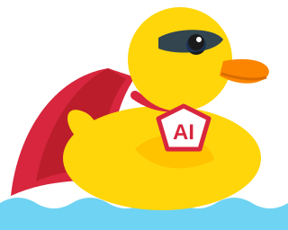

<p align="center">
  
</p>

# duck-kit

**duck** es un plugin de Claude Code que pone orden en el trabajo diario con tickets y git. Le decís qué
ticket vas a hacer; duck crea la rama correcta, mueve el ticket a «en proceso», no te deja romper la rama
base y, cuando terminás, te pide **una sola autorización** para subir el código, abrir el PR, mergear y
cerrar el ticket.

Funciona con **Jira** o con **GitHub Issues + Projects**.

## Qué problema resuelve

Sin una regla compartida, cada persona (y cada agente) trabaja distinto: ramas con nombres inventados,
pushes directos a `develop`, tickets que quedan «en proceso» semanas después del merge, PRs que nadie sabe
a qué ticket pertenecen. duck convierte esas costumbres en reglas que se cumplen solas:

| Regla | Qué la hace cumplir |
|---|---|
| Una rama por ticket, creada desde la base al día | `/duck:tomar` crea la rama; un hook avisa si reusás la clave con otro nombre |
| Nadie empuja ni mergea a mano sobre la rama base | Un hook bloquea `git push` a la base, el merge local y `git branch -D` |
| Una sola puerta hacia el remoto | Push, PR y merge se piden juntos, una vez, al final |
| El ticket sigue al código | Pasa a «en proceso» al tomarlo y a «finalizado» al mergear, sin que lo pidas |

## Cómo se ve un día con duck

```text
/duck:tomar PROJ-123        # lee el ticket, crea feature/PROJ-123-slug, lo pasa a En Proceso
... trabajás con Claude ...  # commits locales, tests; nada sale de tu máquina
"listo, cerralo"             # duck corre la suite, rebasea sobre la base y te pide UN sí
sí                           # push, PR, merge y ticket en Finalizado
```

Mientras tanto ves:

- **Status line**: la tarea de esta sesión y su estado.
- **Panel lateral** (`/duck`): las historias, sus sub-tareas, en qué rama está el código de cada una y
  alertas (rama atrasada, clave reusada, sub-tarea bloqueada). Un pato 🦆 nada en el panel mientras
  Claude está procesando.

¿Querés probar una idea sin ticket? `/duck:spike <tema>` crea una rama `spike/<tema>` local: sin push, sin
PR y sin tocar Jira. Si sale bien, `/duck:tomar <clave> desde-spike` la convierte en una tarea real.

## Instalación

Requisitos: Claude Code ≥ 2.1.287, `node` y `git`. Según el proveedor: el MCP de Atlassian (y opcionalmente
`acli`) para Jira, o `gh` con el scope `project` para GitHub.

```bash
git clone https://github.com/miguel-anay/duck-kit.git
cd duck-kit
bash instalar.sh          # Linux y macOS
pwsh -File instalar.ps1   # Windows
```

El instalador se puede correr varias veces: registra el marketplace, instala `duck@duck-kit` y configura
el status line.

## Activarlo en un proyecto

duck no hace nada en un proyecto hasta que lo adoptás. Abrí Claude Code en el proyecto y corré:

```text
/duck:iniciar
```

Detecta los repos, la rama base y el proveedor de tickets, te pregunta lo que no puede adivinar (de a una
pregunta) y te muestra los dos archivos que va a escribir antes de hacerlo:

- `.claude/duck.json`: configuración (clave de Jira o Project de GitHub, estados, rama base, repos).
- `.claude/duck/convenciones.md`: lo propio del proyecto que leen los agentes (comandos de test, reglas).

También te dice qué le falta a la carpeta de docs del proyecto y la crea solo si aceptás (ver
«Documentación y base de conocimiento»). Después: `/reload-plugins` y `/duck:tomar <clave>`.

## Cómo detecta la forma de trabajar del equipo

`/duck:iniciar` no parte de una plantilla fija: primero mira lo que el equipo ya hace, y solo pregunta lo
que no se puede leer. Nunca lee archivos con secretos (`.env` y parecidos) ni hace `fetch`.

| Qué detecta | De dónde lo saca |
|---|---|
| Repos del proyecto | La raíz, o cada subcarpeta que es un repo git, con su nombre en GitHub sacado del remoto |
| Rama base | `develop` si existe; si no, `origin/HEAD` (`main` o `master`) |
| Prefijos de rama | Los que ya usan las ramas remotas (`feature/`, `bugfix/`, `feat/`…) |
| Clave de Jira | El patrón `ABC-123` que más se repite en ramas y en los últimos 50 commits |
| Estados y transiciones | Una sub-tarea y una historia reales, por el MCP de Atlassian o `acli` |
| Project de GitHub | `gh project list` y el campo de estado (`Status`) con sus opciones |
| Borrado de ramas al mergear | `delete_branch_on_merge` de cada repo, por la API de GitHub |
| Reglas que ya existen | Los `CLAUDE.md` de los repos: lo que ya dicen no se copia, se cita |
| Carpeta de docs | La skill `estructura-docs` en modo prueba: el layout y qué carpetas faltan |

Lo que no sale de una respuesta real queda con el valor por defecto y se marca «sin verificar». Después
pregunta, de a una, lo propio del proyecto: tipos de ticket y su repo, orden de la serie, si cada historia
lleva un plan, comandos de test por repo y quién lee los comentarios de cierre.

## Documentación y base de conocimiento

duck no reemplaza la documentación del proyecto: la lee y escribe en ella. Todo es Markdown versionado.

| Qué | Dónde | Quién lo usa |
|---|---|---|
| Reglas del repositorio | `CLAUDE.md` de cada repo | Los cuatro agentes lo leen antes de empezar |
| Lo propio del proyecto | `.claude/duck/convenciones.md` | Agentes y `/duck:tomar`; manda sobre los ejemplos del kit |
| Plan de cada historia | La ruta de `odd.diseno` (por ejemplo `docs/disenos/{historia}.md`) | `analista` lo escribe; las decisiones que cambian el plan se agregan ahí |
| Bitácora de la feature | La carpeta de `odd.tareas` (por ejemplo `odd/tasks/`) | El seguimiento de tareas y la evidencia de cada una |
| El método | [`plugins/duck/METODO.md`](plugins/duck/METODO.md) | La referencia de cómo se trabaja |
| Comentario de cierre | El ticket | La skill `evidencia-de-pruebas`: solo lo que otra persona debe saber o hacer |

### La carpeta de docs

La skill `estructura-docs` arma la misma serie en cualquier proyecto, sin pisar nada de lo que ya existe.
Solo cambia dónde vive:

| Proyecto | Dónde |
|---|---|
| Un repo, o un monorepo (`pnpm-workspace.yaml`, `turbo.json`, `nx.json`, `workspaces`) | `docs/` dentro del repo, con `CHANGELOG.md` |
| Varios repos en una carpeta madre | `doc/` al lado de los repos, como repo git propio, con `changelog/<repo>.md` y `repositories.md` |

La serie, con nombres y plantillas en inglés: `PRD.md`, `TECH-DESIGN.md`, `SECURITY.md`, `DEPLOY.md`, `adr/`,
`specs/`, `templates/`, `manuals/`, `guides/`, `conventions/` (cada regla con quién la hace cumplir), `ai/` y
`odd/`. Si el proyecto ya tiene una carpeta con el nombre viejo en español (`guias/`, `ia/`…), no se duplica:
duck avisa el rename.

**Agentes propios del proyecto.** Se escriben en `ai/agents/` (la fuente versionada, a partir de
`templates/ai-agent.md`) y se instalan en `.claude/agents/` de la raíz del proyecto, donde Claude los lee:

```sh
sh docs/ai/install-agents.sh                                        # Linux, macOS (doc/ con varios repos)
powershell -ExecutionPolicy Bypass -File docs/ai/install-agents.ps1 # Windows
```

Se vuelve a correr al clonar, al crear un agente o al traer cambios de otro: refresca la copia. Los cuatro
agentes de duck no van ahí: los trae el plugin.

Si el proyecto tiene una base de conocimiento (decisiones de arquitectura, guías del equipo), citala desde
`convenciones.md` y los agentes la siguen. Si contradice al método, gana la regla del proyecto.

## Buenas prácticas que aplica

- **Una clave, un trabajo.** Un trabajo distinto lleva su propia sub-tarea; dos ramas bajo una clave
  rompen la trazabilidad.
- **Suite en verde antes de integrar**, y otra vez después de rebasear sobre la base.
- **Rebase antes del push, nunca después.** Una rama publicada no se reescribe.
- **El merge se hace sobre el PR**, nunca con `git merge` local ni `git push` a la base.
- **Varios repos, varios PR unidos por la clave**, en orden (backend antes que frontend, o el que fije el
  proyecto).
- **El agente reporta evidencia; no confirma.** La casilla de «confirmo el correcto funcionamiento» la firma
  una persona, con nombre y fecha.
- **Probar sin comprometer.** Una idea dudosa va a un spike local antes de tener ticket.
- **Pedir permiso una vez.** Todo lo local corre sin preguntar; la única pregunta es la puerta al remoto.

**Límites.** Los hooks leen el texto del comando: un `sh -c`, un alias o un script propio los esquivan. Son
una red para el trabajo de todos los días, no un sandbox. Si un guardia no puede revisar (sin red, `gh`
caído), deja pasar el comando y lo avisa.

## Comandos y skills

Los comandos son skills del plugin que solo invocás vos; `/duck:estado` también lo puede usar Claude.

| Comando | Para qué |
|---|---|
| `/duck:iniciar` | Configura duck en el proyecto. |
| `/duck:tomar <clave>` | Arranca una tarea (o una historia entera con sus sub-tareas). |
| `/duck:estado` | Muestra cómo va la historia: sub-tareas, ramas, repos y alertas. |
| `/duck:spike <tema>` | Rama local de prueba, sin ticket ni remoto. |
| `/duck` | Abre o cierra el panel lateral. |

Dos skills más que Claude carga sola cuando hacen falta: `evidencia-de-pruebas` (el comentario de cierre
del ticket) y `estructura-docs` (dónde va cada documento y la carpeta de docs).

También trae cuatro agentes que Claude usa solo: `analista` (decide el enfoque), `escritor` (implementa),
`explorador` (mapea código) y `verificador` (corre la suite y contrasta con el ticket).

## Glosario

- **Rama base**: la rama de integración (`develop`, o `main` en GitHub). Nadie trabaja directo en ella.
- **Clave**: el identificador del ticket: `PROJ-123` en Jira, `#12` u `owner/repo#12` en GitHub.
- **Modo tarea / flujo / spike**: una sub-tarea por vez; una historia completa en secuencia; una prueba
  local sin ticket.
- **La puerta**: el único momento en que duck pide permiso; todo lo anterior es local.

## Herramientas opcionales

duck funciona igual sin ellas; el instalador no las instala.

- [Obsidian](https://obsidian.md): para leer como vault la documentación Markdown que escriben duck y los
  agentes. Desactivá *Usar [[Wikilinks]]* para que escriba Markdown estándar.
- [Graphify](https://github.com/Graphify-Labs/graphify): grafo del código para repos grandes. Todavía no
  está integrado con `duck:explorador`, y el grafo se queda viejo si nadie lo regenera.

## Para saber más

- [`plugins/duck/README.md`](plugins/duck/README.md): cada pieza (hooks, skills, agentes, panel), instalación a
  mano y referencia completa de `duck.json`.
- [`plugins/duck/METODO.md`](plugins/duck/METODO.md): el método paso a paso: modos, la secuencia de
  cierre y cómo se mueve el ticket.
- [`plugins/duck/plantillas/`](plugins/duck/plantillas/): ejemplos de `duck.json` (Jira y GitHub) y de
  convenciones.
